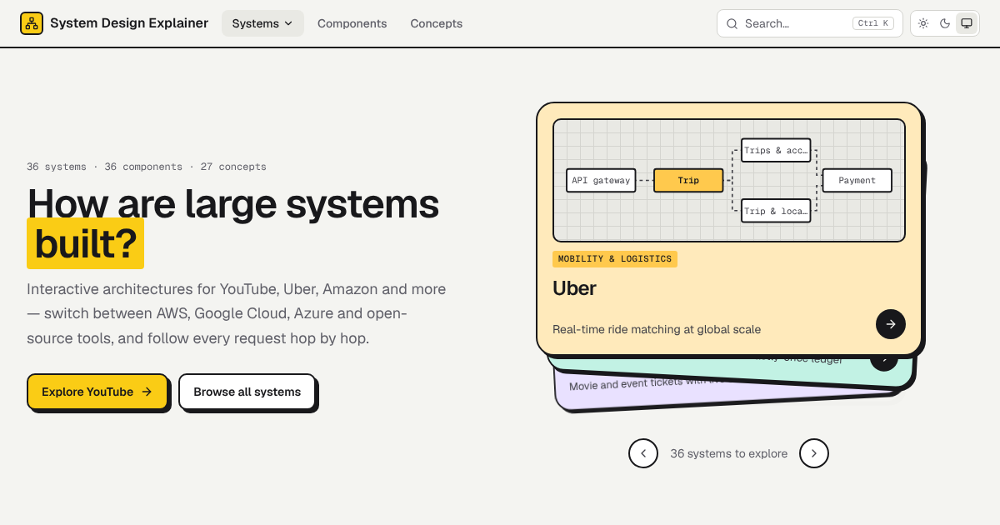
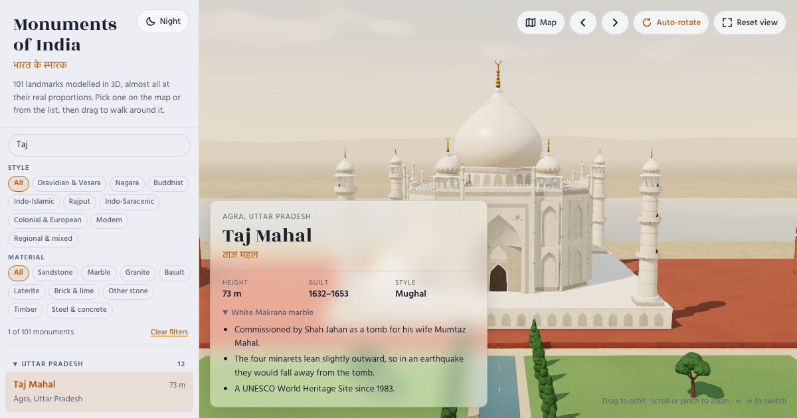
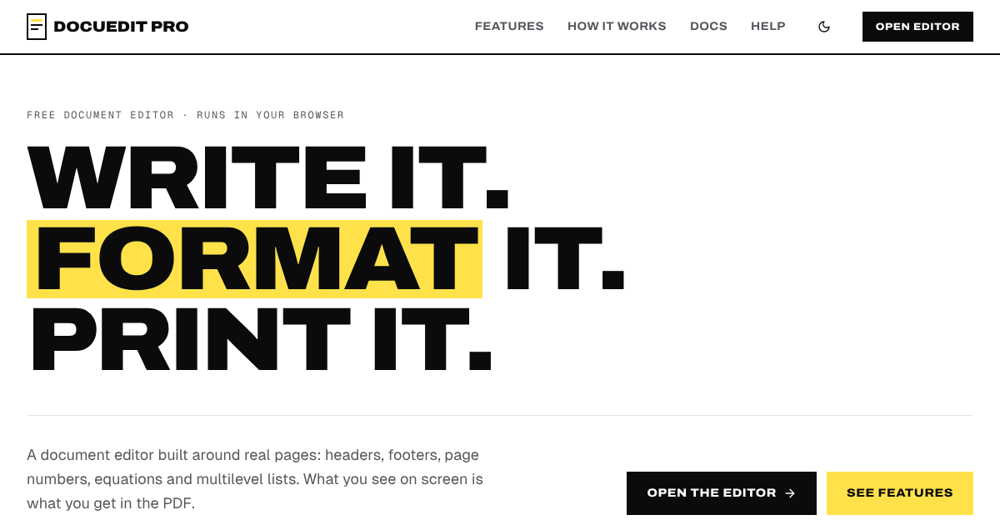
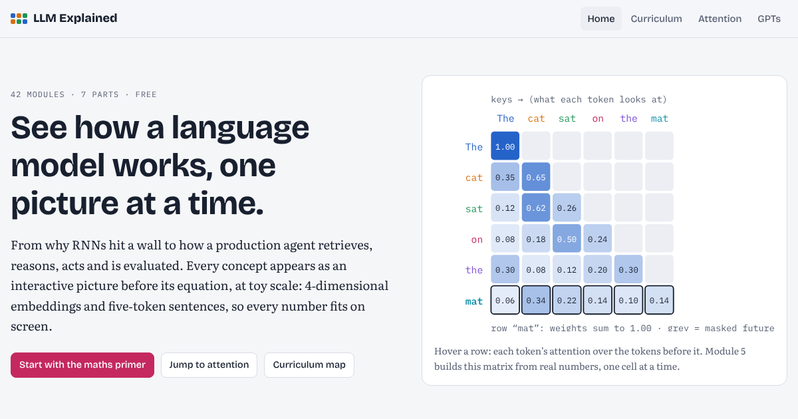

**Learning Machine Learning & Generative AI, one project at a time.**

## 🧭 About me

|     |     |
| --- | --- |
| 🌱 **Learning** | Machine Learning and Generative AI |
| 👯 **Collaborating on** | Agentic AI projects, so reach out if you're building one |
| 🤔 **Looking for** | Help and recommendations on new Gen AI tools |
| 📫 **Reach me** | [amananandrai@gmail.com](mailto:amananandrai@gmail.com) |

## 🛠️ Tech stack

<table>
  <tr>
    <td><b>Languages</b></td>
    <td>
      
      
      
    </td>
  </tr>
  <tr>
    <td><b>ML / AI</b></td>
    <td>
      
      
    </td>
  </tr>
  <tr>
    <td><b>Web</b></td>
    <td>
      
      
    </td>
  </tr>
  <tr>
    <td><b>Databases</b></td>
    <td>
      
      
      
    </td>
  </tr>
  <tr>
    <td><b>Tools &amp; Cloud</b></td>
    <td>
      
      
      
      
      
    </td>
  </tr>
</table>

## 🚀 Featured projects

<table>
  <tr>
    <td width="50%" valign="top">
      
      <h3><a href="https://github.com/amananandrai/system-design-explainer">System Design Explainer</a> · <a href="https://system-design-explainer.vercel.app/">Live</a></h3>
      
Interactive explainer of how YouTube, Uber, Amazon and 30+ systems are built, with architectures switchable between AWS, GCP, Azure and open source.

      
      
    </td>
    <td width="50%" valign="top">
      
      <h3><a href="https://github.com/amananandrai/monuments-of-india">Monuments of India</a> · <a href="https://monuments-of-india-nu.vercel.app">Live</a></h3>
      
101 landmarks modelled in 3D, almost all at their real proportions. Pick one on the map or from the list, then drag to walk around it.

      
      
      
    </td>
  </tr>
  <tr>
    <td width="50%" valign="top">
      
      <h3><a href="https://github.com/amananandrai/document-editor-with-tiptap">Docuedit Pro</a> · <a href="https://document-editor-react-tiptap.vercel.app/">Live</a></h3>
      
A free browser-based document editor built around real pages: headers, footers, page numbers, equations and multilevel lists, with what you see matching the PDF.

      
      
      
    </td>
    <td width="50%" valign="top">
      
      <h3><a href="https://github.com/amananandrai/llm-explained">LLM Explained</a> · <a href="https://llm-explained-lovat.vercel.app/">Live</a></h3>
      
See how a language model works, one picture at a time: 42 interactive modules across 7 parts, from the maths primer to attention and production agents.

      
      
    </td>
  </tr>
</table>

➡️ [See all repositories](https://github.com/amananandrai?tab=repositories)

## 📝 Latest writing

I write about ML and AI on [DEV](https://dev.to/amananandrai):

| Article | Topic |
| --- | --- |
| [10 famous Machine Learning Optimizers](https://dev.to/amananandrai/10-famous-machine-learning-optimizers) | Optimization |
| [6 Explainable AI (XAI) Frameworks for Transparency in AI](https://dev.to/amananandrai/6-explainable-ai-xai-frameworks-for-transparency-in-ai) | Explainability |
| [Natural Language Processing Performance Metrics (Benchmarks)](https://dev.to/amananandrai/natural-language-processing-performance-metrics-benchmarks) | NLP |
| [Language Model Implementation (Bigram Model)](https://dev.to/amananandrai/language-model-implementation-bigram-model) | Language models |

➡️ [More articles on my DEV profile](https://dev.to/amananandrai)

## 📊 Stats

### 💻 Competitive coding

### 💬 Q&amp;A communities

## 🏅 Holopin badges

